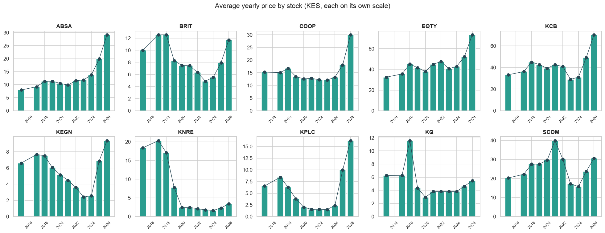
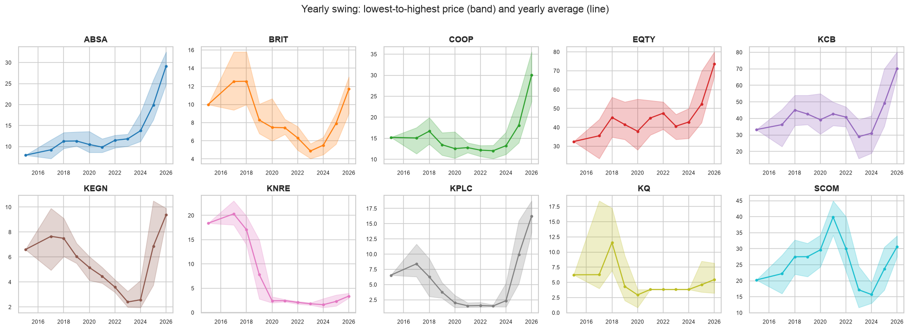
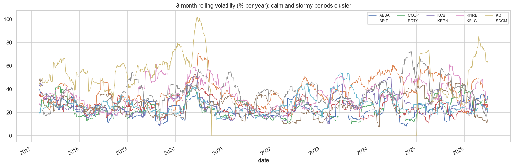
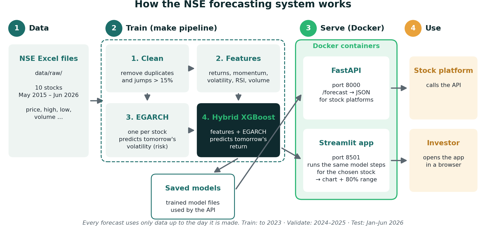
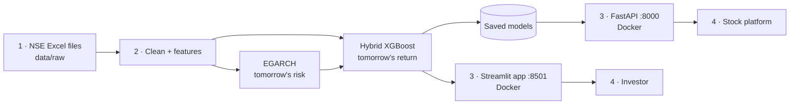

# Forecasting NSE Stock Prices with a Hybrid EGARCH–XGBoost Model

**DSA 8401 Applied Machine Learning · Capstone Project · Strathmore University (iLabAfrica)**
**Author:** Jimcollins Wamae Wanguku · November 2026

An end-to-end system that forecasts next-day returns, prices and likely price ranges for 10 Nairobi Securities Exchange (NSE) stocks. It combines an econometric volatility model (**EGARCH**) with a machine-learning model (**XGBoost**). The model is served through a **FastAPI** service and a **Streamlit** app, both packaged with **Docker**.

> ⚠️ **Disclaimer:** This project is for academic research only. It is **not financial advice**.

---

## Contents
1. [Problem](#1-problem)
2. [Data](#2-data)
3. [The stocks](#3-the-stocks)
4. [Architecture](#4-architecture)
5. [Method and technique justification](#5-method-and-technique-justification)
6. [Results](#6-results)
7. [Deployment](#7-deployment)
8. [How to reproduce](#8-how-to-reproduce)
9. [Repository structure](#9-repository-structure)
10. [Limitations and next steps](#10-limitations-and-next-steps)

---

## 1. Problem
**What is predicted:** each stock's log return for the next trading day, $r_{t+1}=\ln(P_{t+1}/P_t)$. From it, the system derives the next-day price and an 80% likely range.

**Why it matters:** NSE investors, brokers and analysts need short-term risk and price guidance. NSE stocks are hard to forecast because many trade thinly, prices jump on corporate actions, and calm periods alternate with volatile ones.

---

## 2. Data
| Item | Detail |
|---|---|
| Source | NSE daily equity trading data (Excel). *Add the exact provider.* |
| Period | 9 May 2015 – 30 June 2026, trading days only |
| Size | 23,540 raw rows → 23,530 after cleaning (10 stocks × 2,353 trading days) |
| Raw variables | `YEAR, DATE, CODE, NAME, 12m Low, 12m High, Day Low, Day High, Day Price, Previous, Change, Change%, Volume` |
| Location | `data/raw/` (not committed to the repository) |

**Real-world messiness found and handled**

| Issue | Count | Handling |
|---|---|---|
| Duplicate (date, code) rows | 10 | Keep the last record |
| Missing `Change` / `Change%` | 4,830 (20.5%) | Recomputed from prices |
| Missing `Volume` | 1,130 (4.8%) | Treated as zero for volume features |
| Price outside the day's range | 3 | Kept and flagged |
| Daily moves above 15% (splits, bonus issues, errors) | 15 | Excluded from returns and modelling |
| Thin trading | KQ: 53% of days with no price change | Captured by a `stale_5` feature |

---

## 3. The stocks
| Code | Company | Sector | Last price (KES) | Low – High (KES) | Annual volatility | No-change days |
|---|---|---|---|---|---|---|
| ABSA | ABSA Bank Kenya Plc | Banking | 32.05 | 7.15 – 32.55 | 24.3% | 20.9% |
| BRIT | Britam Holdings Plc | Insurance | 12.55 | 4.05 – 15.80 | 39.0% | 12.3% |
| COOP | Co-operative Bank of Kenya Ltd | Banking | 34.30 | 10.20 – 35.55 | 25.2% | 19.9% |
| EQTY | Equity Group Holdings Plc | Banking | 80.00 | 23.50 – 80.00 | 25.9% | 17.4% |
| KCB | KCB Group Plc | Banking | 78.75 | 15.75 – 80.25 | 27.2% | 15.6% |
| KEGN | Kenya Electricity Generating Company Plc | Energy | 9.76 | 1.96 – 10.50 | 28.6% | 20.8% |
| KNRE | Kenya Re-Insurance Corporation Ltd | Insurance | 3.33 | 1.04 – 23.00 | 36.6% | 15.3% |
| KPLC | Kenya Power and Lighting Company Plc | Energy | 17.15 | 1.24 – 18.75 | 37.8% | 19.3% |
| KQ | Kenya Airways Plc | Aviation | 5.86 | 0.86 – 18.45 | 42.7% | 53.0% |
| SCOM | Safaricom Plc | Telecommunications | 34.05 | 11.65 – 44.95 | 27.5% | 15.8% |

**How prices moved (average closing price per year, KES)**

| Stock | 2017 | 2019 | 2021 | 2023 | 2024 | 2025 | 2026 (H1) |
|---|---|---|---|---|---|---|---|
| ABSA | 9.24 | 11.33 | 9.87 | 11.84 | 13.77 | 19.92 | 29.18 |
| BRIT | 12.54 | 8.29 | 7.44 | 4.88 | 5.52 | 7.92 | 11.70 |
| COOP | 15.09 | 13.48 | 12.80 | 12.06 | 13.26 | 18.12 | 30.02 |
| EQTY | 35.55 | 41.50 | 44.99 | 40.63 | 42.85 | 52.37 | 73.53 |
| KCB | 36.25 | 42.65 | 42.74 | 29.00 | 31.07 | 49.09 | 70.33 |
| KEGN | 7.66 | 6.04 | 4.47 | 2.40 | 2.58 | 6.86 | 9.37 |
| KNRE | 20.32 | 7.80 | 2.45 | 1.81 | 1.62 | 2.29 | 3.40 |
| KPLC | 8.41 | 3.78 | 1.53 | 1.50 | 2.36 | 9.95 | 16.25 |
| KQ | 6.28 | 4.34 | 3.83 | 3.83 | 3.83 | 4.62 | 5.46 |
| SCOM | 22.21 | 27.52 | 39.89 | 17.18 | 15.70 | 23.67 | 30.63 |

**Key patterns**
- **A broad rally in 2025–2026.** After weak years in 2022–2023, most stocks rose sharply. Average prices jumped in 2025 for KPLC (+321%) and KEGN (+166%).
- **Long declines.** KNRE fell from about KES 20 in 2017 to under KES 2 in 2023–2024. KQ's price barely moved for 2021–2024 because it was hardly traded.
- **Volatility clusters.** ARCH-LM tests are significant for all 10 stocks.
- **Fat tails.** Every stock rejects normality (Jarque-Bera p < 0.001). ABSA's excess kurtosis is 11.6.
- **Low co-movement,** except among the banks (EQTY–KCB correlation 0.48).

Charts: `reports/figures/` (generated by the notebook) and `docs/images/` (generated by `scripts/make_readme_charts.py`).





---

## 4. Architecture



**How it works, in four steps**

| Step | What happens | Where |
|---|---|---|
| **1. Data** | Daily NSE Excel files for the 10 stocks go into one folder | `data/raw/` |
| **2. Train** | One command cleans the data, builds features, fits **EGARCH** (tomorrow's risk) and the **hybrid XGBoost** (tomorrow's return), then saves the models | `make pipeline` |
| **3. Serve** | Two Docker containers: a **FastAPI** service that returns forecasts as JSON, and a **Streamlit** app that shows a chart with a likely range | ports `8000` and `8501` |
| **4. Use** | A stock platform calls the API; an investor opens the app in a browser | browser or API call |

The same flow as a text diagram (renders on GitHub):



---

## 5. Method and technique justification

### 5.1 Time split (no shuffling, no look-ahead)
| Set | Period | Rows | Use |
|---|---|---|---|
| Train | May 2015 – Dec 2023 | 17,332 | Fit EGARCH and XGBoost |
| Validation | 2024 – 2025 | 4,963 | Tune hyperparameters, early stopping |
| Test | Jan – Jun 2026 | 1,210 | Final evaluation, used once |

### 5.2 Models
| Model | Role |
|---|---|
| Random walk | Baseline: predicts no change tomorrow |
| Historical mean | Baseline: each stock's average training return |
| EGARCH(1,1,1), Student-t | One per stock. Volatility with an asymmetry (leverage) term. Fitted on training data, then frozen |
| XGBoost | One pooled model across stocks with 20 technical features (lags, momentum, volatility, range, RSI, volume, thin trading, market return) |
| **Hybrid EGARCH–XGBoost** | XGBoost plus `eg_vol` (tomorrow's EGARCH volatility), `eg_z` (today's standardised shock) and `vol_gap` (`eg_vol` / 21-day volatility) |

**Leakage controls:** each feature for day *t* uses data up to day *t* only. EGARCH parameters are fixed after training, and `eg_vol` is computed from today's shock and today's volatility.

**Tuning:** an 8-setting grid (depth 3/5, learning rate 0.03/0.1, minimum child weight 5/50), scored on validation RMSE with early stopping. The final model is refit on train + validation, using the Pseudo-Huber loss because returns have fat tails.

### 5.3 Why these techniques
- **EGARCH:** all 10 stocks show volatility clustering, and the leverage term captures asymmetric reactions to bad news. Student-t errors handle the fat tails.
- **XGBoost:** captures non-linear interactions between technical signals and works well on tabular data. Pooling the stocks gives about 17,000 training rows instead of about 2,000 per stock. It is also fast to retrain and serve.
- **Hybrid:** tests whether volatility information improves the return forecast.

### 5.4 Why not others
| Alternative | Reason ruled out |
|---|---|
| LSTM / Transformers | About 2,350 days per stock is small for deep sequence models, and thin trading adds noise. Harder to explain and serve |
| ARIMA alone | Models the mean only and ignores volatility clustering |
| Pure GARCH for returns | A constant-mean model has almost no directional skill (confirmed: EGARCH-mean RMSE ≈ random walk) |
| Random split / k-fold CV | Leaks future information in time series |

---

## 6. Results
Test period: January – June 2026 (1,210 stock-days). Full tables are in `reports/model_results.csv` and notebook section 5.7.

**Diebold-Mariano tests (squared-error loss, test set)**
| Comparison | DM statistic | p-value | Result |
|---|---|---|---|
| Hybrid vs random walk | −3.89 | 0.0001 | Hybrid better |
| Hybrid vs EGARCH | −4.02 | 0.0001 | Hybrid better |
| XGBoost vs random walk | −4.35 | < 0.0001 | XGBoost better |
| Hybrid vs XGBoost | 1.02 | 0.31 | No significant difference |

**Test RMSE of next-day return (%), by stock**
| Stock | Random walk | XGBoost | Hybrid | Hybrid vs random walk |
|---|---|---|---|---|
| ABSA | 1.907 | 1.726 | 1.745 | −8.5% |
| BRIT | 2.435 | 2.326 | 2.302 | −5.4% |
| COOP | 1.778 | 1.693 | 1.696 | −4.6% |
| EQTY | 1.548 | 1.524 | 1.523 | −1.6% |
| KCB | 1.397 | 1.358 | 1.365 | −2.3% |
| KEGN | 0.947 | 0.886 | 0.881 | −6.9% |
| KNRE | 2.315 | 1.931 | 1.990 | −14.0% |
| KPLC | 1.634 | 1.472 | 1.470 | −10.0% |
| KQ | 4.238 | 3.696 | 3.778 | −10.9% |
| SCOM | 1.370 | 1.357 | 1.341 | −2.1% |

**Interpretation**
- Both ML models beat the random walk on **every stock**, and the difference is statistically significant.
- The hybrid's gain over XGBoost alone is **not significant**. The EGARCH features rank among the hybrid's important inputs (`eg_z`, `vol_gap`), but they add little to the return forecast itself.
- EGARCH's main value is the **risk range**. For Safaricom, 92.6% of test days fell inside the 80% range, so the range is slightly conservative.
- **EGARCH parameters:** median persistence β = 0.75. Five of 10 stocks show a leverage effect (γ < 0).

---

## 7. Deployment
| Component | File(s) | Port | Purpose |
|---|---|---|---|
| Pipeline | `Makefile`, `src/` | – | Ingest → features → train → save artifacts |
| API | FastAPI service, `Dockerfile` | 8000 | Send a stock code, get a forecast back as JSON. Docs at `/docs` |
| Web app | `app.py`, `Dockerfile.app`, `requirements-app.txt` | 8501 | Choose a stock and a horizon (1 day, 1 week, 2 weeks, 1 month or 3 months) and get a chart with a dotted forecast line and an 80% range |

**From a one-day model to longer horizons (app)**
1. **Day 1:** the hybrid model's return, capped at ±2× the EGARCH volatility.
2. **Later days:** the signal halves each day toward the stock's small long-run trend.
3. **Range:** EGARCH volatility fades to the stock's 12-month normal level and is capped between 0.25× and 3× that level. This fixed unrealistic ranges on thinly traded stocks such as KQ.

---

## 8. How to reproduce

### Requirements
Python 3.12, `make`, and Docker Desktop.

### Steps
```bash
git clone https://github.com/<your-username>/nse-forecast.git
cd nse-forecast
make setup PY=python3.12            # creates .venv and installs dependencies
# copy the NSE Excel file(s) into data/raw/
make pipeline                       # clean → features → train → save models
make test                           # run the tests, including the no-leakage check
```

| Task | Command |
|---|---|
| Run the API locally | `make serve` → http://127.0.0.1:8000/docs |
| Call the API (demo) | `make demo` |
| API in Docker | `make docker` |
| App locally | `.venv/bin/streamlit run app.py` → http://localhost:8501 |
| App in Docker | `docker build -f Dockerfile.app -t nse-app .` then `docker run --rm -p 8501:8501 nse-app` |
| Both with Compose | `docker compose up --build` |
| Notebook | open `Reports & Notebook/nse_forecasting_notebook.ipynb`, then **Restart → Run All** |
| README charts | `.venv/bin/python scripts/make_readme_charts.py` |

`docker-compose.yml` (place it in the repository root):
```yaml
services:
  api:
    build: { context: ., dockerfile: Dockerfile }
    ports: ["8000:8000"]
  app:
    build: { context: ., dockerfile: Dockerfile.app }
    ports: ["8501:8501"]
```

---

## 9. Repository structure
```
nse-forecast/
├── README.md
├── AI_USE.md
├── Makefile
├── Dockerfile                 # API image
├── Dockerfile.app             # Streamlit image
├── docker-compose.yml
├── requirements.txt
├── requirements-app.txt
├── app.py                     # Streamlit forecast app
├── src/                       # pipeline and API code
├── tests/
├── Reports & Notebook/             # notebook, PDF and presentation
│   ├── nse_forecasting_notebook.ipynb
│   ├── nse_forecasting_notebook.pdf
│   └── NSE_Forecasting_Capstone.pptx
├── scripts/
│   ├── make_readme_charts.py
│   └── make_architecture_diagram.py
├── data/raw/                  # not committed
├── reports/figures/           # notebook charts
└── docs/images/               # README charts
```

---

## 10. Limitations and next steps
- **Unstable EGARCH on KQ:** the fit gave extreme parameters (α ≈ −3,858) because of heavy thin trading. A per-stock fallback (GJR-GARCH or rolling volatility) is needed.
- **EGARCH volatility in the test window:** it tracked actual moves in validation (correlation 0.32) but not in test (≈ 0). A simple 21-day volatility held up better (0.36). Re-estimating monthly should help.
- **Horizon:** the forecasting edge is mainly one day ahead. Longer horizons rely on volatility and trend.
- **Tradability:** gains from thin-trading patterns may disappear after costs.
- **Next steps:** drift monitoring (Evidently AI), MLflow experiment tracking, GitHub Actions CI, SHAP explanations and a live data feed.
